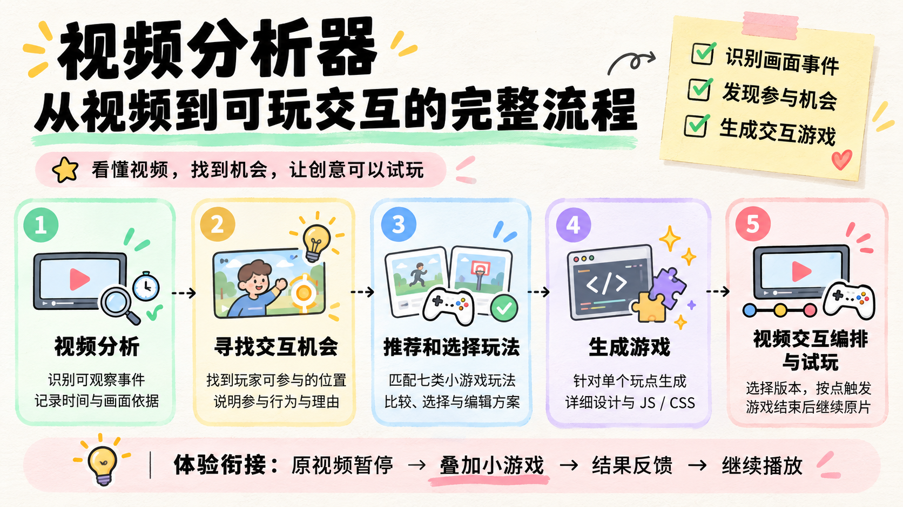
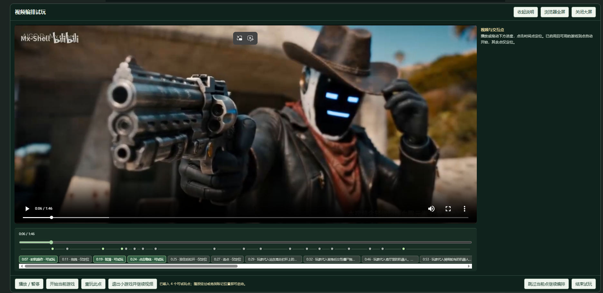

<div align="center">

# 视频分析器 · Video Analyzer

**把视频中的参与机会，做成可以试玩的小游戏。**

视频理解 · 交互设计 · AI 生成 JavaScript · 视频编排

[快速开始](#快速开始) · [使用流程](#使用流程) · [模型配置](#模型配置) · [常见问题](#常见问题) · [开发与贡献](#开发与贡献)

</div>



## 这个项目做什么

给出一段视频，AI 先描述画面中发生的事件，再寻找玩家可以参与的位置，并推荐合适的玩法。你可以回看画面、调整时间、选择或修改方案，再为选中的**单个玩点**生成游戏，最后沿视频时间轴连续试玩。

例如：人物刚拿到物体时，可以设计一次力度控制；角色准备起跑时，可以加入时机操作。AI 提供建议，你决定哪些内容值得保留，以及最终怎么玩。

交互通过以下方式衔接：

**播放原视频 → 到点暂停 → 叠加小游戏 → 显示结果 → 继续原视频。**

玩家操作影响小游戏结果，原视频仍按已有内容播放。目前不生成新的剧情视频，也不直接修改原片中的人物动作。

## 可以做什么

| 能力 | 你可以完成的操作 |
| --- | --- |
| 看懂视频 | 选择直接视频或顺序抽帧，查看事件及代表画面，点击定位回看 |
| 找到参与位置 | 筛选候选交互点，调整时间，人工新增或删除 |
| 设计玩法 | 比较 AI 推荐、编辑独立方案，也可以自行设计 |
| 生成小游戏 | 每次只生成一个玩点的详细设计、JS 和 CSS，按具体问题修复新版本 |
| 大屏试玩 | 查看目标与操作说明，单点试玩或通过时间轴进入游戏 |
| 连续编排 | 选择每点的游戏版本，启用后随视频播放依次触发 |
| 保存成果 | 保存项目、管理版本、记录试玩、导出备份，回收与恢复游戏及交互点 |
| 查看调用 | 查看后台生成状态、等待时间、Token 用量和原始记录 |

支持七类玩法：**点击物体、剧情选择、时机操作、按住后松开、连点、拖拽、短滑**。是否适合某种玩法，取决于当前画面和玩家目标，不要求每个镜头都有交互。



## 快速开始

### 1. 准备运行环境

下载或克隆仓库，在项目根目录打开终端。需要安装：

| 工具 | 用途 |
| --- | --- |
| Python 3.10+ | 启动本地服务；后端使用标准库 |
| FFmpeg、ffprobe | 读取视频信息、抽帧和处理片段 |
| Node.js | 检查生成的 JavaScript 语法，运行前端测试 |
| 浏览器 | 打开工作台；建议使用较新的 Chrome 或 Edge |

可以先检查命令是否可用：

```sh
python --version
ffmpeg -version
ffprobe -version
node --version
```

**无需 Docker、前端打包或额外安装 Python／npm 依赖。** FFmpeg、ffprobe 和 Node 可以加入 `PATH`，也可以稍后在页面设置中填写可执行文件路径。

### 2. 启动工作台

```sh
python demo/app.py
```

打开 **[http://127.0.0.1:8765](http://127.0.0.1:8765)**，点击右上角“设置”配置模型服务。页面可以在没有密钥时打开；实际分析和生成需要有效的模型配置。

服务运行期间保持终端打开。端口被占用时：

```sh
python demo/app.py --port 8766
```

然后访问 `http://127.0.0.1:8766`。

### 3. 准备一段视频

支持 **MP4，最长 120 秒，最大 30 MiB**。首次体验建议使用十几秒、主体和动作清楚的片段。

你可以直接上传，也可以把素材放入 `mp4-example/`，刷新页面后选择。项目不保证附带可分发的示例视频，请自行准备有权使用的素材。

> 分析、推荐、生成和修复会请求你配置的模型服务，可能产生费用。查看已有结果、编辑方案、保存项目和试玩现有版本不调用模型。

## 使用流程

工作台分成五个工作区。可以先完成一个玩点，再扩展到整段视频。

| 步骤 | 怎么操作 | 得到什么 |
| --- | --- | --- |
| **1. 视频分析** | 选择输入方式与模型，识别事件，回看并勾选要继续分析的画面 | 带位置的可观察事件 |
| **2. 交互点管理** | 寻找参与机会，调整位置或新增、删除，选入需要的点后进入下一步 | 玩家可参与的行为及理由 |
| **3. 玩法推荐与选择** | 为已选点推荐玩法，比较方案，在弹窗中编辑描述，或自行设计 | 每个点采用的玩法方案 |
| **4. 游戏生成与管理** | 核对单点输入并生成，查看设计、版本和代码，再试玩或按需修复 | 可检查和运行的游戏版本 |
| **5. 视频交互编排** | 选择采用版本及参与开关，保存编排，在大屏中回看或连续试玩 | 视频与小游戏的衔接体验 |

**推荐的第一次体验：** 选一个画面清楚的点 → 确定一种玩法 → 生成一个游戏 → 检查操作、反馈和退出 → 采用版本并加入视频。确认这个过程后，再处理其他点。

使用时注意：

- **选点与选玩法是两件事。** 先把候选点送入后续流程，再确定该点采用的方案。
- **补充说明可以留空。** 新增画面元素、详细判定规则和视频衔接说明可由生成阶段补全，核心目标与操作仍应写清楚。
- **生成不会自动试玩。** 先查看结果，再由你启动。后台任务在本地服务中执行，关闭面板不取消任务；刷新后可继续查看，服务需要保持运行。
- **已有版本可以反复使用。** 改动点位或玩法后应核对旧游戏是否仍匹配。检查通过仅表示完成规定检查，仍需实际试玩成功、失败、超时和退出。

## 模型配置

所有日常配置通过页面“设置”完成，**不需要创建 `.env`**。保存后新工作流使用新配置，已经开始的工作流保留原快照。

### 分析与生成如何分工

| 阶段 | 需要什么模型 | 发送什么 |
| --- | --- | --- |
| 事件识别 | 支持相应视频或图片格式的多模态模型 | 直接视频，或顺序图片与时间戳 |
| 交互机会、玩法推荐 | 能读取图片的多模态模型 | 对应图片、事件文字和参与目标 |
| 游戏生成与修复 | 当前接入 MiniMax 文字生成接口 | 单个玩点的方案；修复时附带旧版本及问题 |

分析服务通过 OpenAI 兼容的 `/chat/completions` 接口调用，页面可填写云端网关或兼容的内网服务。兼容文字接口不代表一定支持图片、视频及所有请求参数，模型名称应与服务端提供的名称完全一致。

| 设置页 | 主要内容 |
| --- | --- |
| 视频分析 | API 地址、密钥、模型列表、输出上限、Qwen 思考模式及参数位置、玩法批次 |
| 游戏生成 | MiniMax API 地址、密钥、模型、思考深度及输出上限 |
| 本地工具 | FFmpeg、ffprobe、Node 路径；留空使用 `PATH`，可检测已保存路径 |

项目默认分析地址为 `https://beeroute.ai/v1`，生成地址为 `https://api.minimax.cn/v1`，生成模型为 `MiniMax-M3.1-Flash`。这些是项目配置默认值，能否调用取决于你的服务和账号权限。

### 内网与慢请求

- API 地址支持 HTTPS；内网 IP 和 localhost 也支持 HTTP。
- Qwen 思考参数可选顶层 `enable_thinking` 或 `chat_template_kwargs`，按部署实际支持方式设置。**以返回的思考 Token 和内容核验是否生效**，不能只看请求写了关闭。
- 分析输出额度默认 **16384 Token**，包含模型返回的思考开销；提高上限可能增加耗时与实际用量。
- 玩法推荐每批支持 **1–5 个点**，默认 5。慢推理部署可尝试缩小批次，例如 2 点；小批次会增加请求次数，不会删除对应图片。
- 未完成点单独标记，可以只推荐该点。失败的玩法批次不自动重试，缺失用量不会按零计入总量。

## 保存、备份与数据

项目采用本地文件保存，无需数据库。

| 内容 | 保存位置与说明 |
| --- | --- |
| 模型与工具设置 | `config/settings.json`，由设置页面管理 |
| 项目草稿与采用关系 | `projects/`，支持继续编辑、另存和草稿备份 |
| 分析与推荐记录 | `results/<模型>/`，保留实际提示词、原始响应、参数、视频哈希和用量 |
| 游戏版本及产物 | `results/<模型>/games/<素材>/<玩点>/`，独立保存 JS、CSS、设计和生成／修复记录 |
| 试玩记录 | 对应玩点的 `试玩/` 子目录，区分运行结果与人工评价 |
| 回收内容 | 项目回收站保存被删除的游戏版本、交互点及关联文件 |

重新打开项目时，**仍需选择原视频**。工作台会核对视频是否匹配，项目文件和备份包不替代原视频。

草稿备份支持导入恢复；单版本和项目游戏 ZIP 用于备份、查看代码与记录，不含原视频或密钥，目前不支持整包一键导入。另存项目副本主要复制草稿，不复制完整游戏库。整个项目删除后移入 `projects/.trash/`，当前没有与游戏回收站相同的页面恢复入口。

## 常见问题

<details>
<summary><strong>直接视频和顺序抽帧，应该选哪个？</strong></summary>

直接视频由服务端处理视频输入，实际采样和支持范围取决于接口；顺序抽帧明确提供图片及时间戳，更方便核对输入，但可能漏掉帧间短动作。先选一个稳定支持的输入方式，再用相同素材比较。当前分阶段主流程以视觉分析为主，文件有音轨不代表模型实际使用了声音。

</details>

<details>
<summary><strong>为什么分析失败后还能看到部分事件？</strong></summary>

较长视频会分段处理。某段失败时，已经通过校验的事件可以保留，页面说明失败或未处理的区间；你可以选择有效部分继续。它不代表全片分析成功。分段和截断恢复可能对应多次请求，应结合记录查看实际调用量。

</details>

<details>
<summary><strong>调用很慢、报错或没有推荐，怎么排查？</strong></summary>

| 现象 | 优先检查 |
| --- | --- |
| 找不到模型、HTTP 404 | 模型名称及大小写是否与服务端一致 |
| HTTP 503／504 | 模型服务可用性、网关超时及批次大小 |
| 输出达到上限、正文不完整 | 结束原因、输出额度、实际思考用量及关闭参数是否生效 |
| 视频预处理或抽帧失败 | FFmpeg／ffprobe 路径及错误详情；能播放不等于一定能被预处理 |
| 找不到 Node | 在“本地工具”填写可执行文件路径，保存后检测 |
| 没有交互点或玩法 | 先区分合理空结果、模型漏答和请求失败，再决定是否调整位置或单点推荐 |

请保留原始错误，不要仅通过放宽所有校验来掩盖问题。详细响应可在视频回看下方的“分析记录与原始响应”中查看。

</details>

<details>
<summary><strong>在哪里看消耗？试玩会再次收费吗？</strong></summary>

页面展示分析、推荐及生成／修复返回的 Token 用量，未返回时保留为未知。这是模型返回的用量，不是自动计算的金额或完整项目账单。已经生成的游戏可以重复试玩，不会因此再次调用模型；主动重新分析、推荐、生成或修复会发起新请求。

</details>

<details>
<summary><strong>这个项目完全离线吗？生成代码安全吗？</strong></summary>

网页、项目和游戏在本机运行，分析与生成会将对应视频、图片或文字发送到你配置的服务；如果使用云端接口，就不是完全离线。密钥保存在本机 `config/settings.json` 中，属于明文配置，分享配置时默认不导出密钥。

生成代码经过检查后在受限沙箱 iframe 中试玩，后端不执行这些游戏代码。浏览器沙箱不提供完整的 CPU／内存隔离，当前工作台面向本地原型创作，不宜直接作为公共代码执行服务部署。分享仓库或备份前，请检查密钥、原始记录与素材授权。

</details>

## 项目结构

```text
Video-analyzer/
├─ demo/
│  ├─ app.py                  启动入口
│  ├─ video_analyzer/         工作流、媒体处理、模型、项目和游戏管理
│  ├─ web/                    页面、原生 JavaScript 与 CSS
│  ├─ tests/                  Python／Node 测试和浏览器夹具
│  └─ tools/                  实验、分析及恢复工具
├─ prompts/
│  ├─ vN.txt、vN/             历史与分阶段提示词
│  ├─ games/                 玩法目录与模板
│  └─ game-generation/        游戏生成和修复提示词
├─ docs/                      图示及文档工具
├─ mp4-example/               自行准备的视频素材
├─ projects/                  本地项目数据
├─ results/                   分析、生成和试玩记录
├─ config/                    本机私有设置
├─ AGENTS.md                  开发约定
└─ README.md
```

## 开发与贡献

后端使用 Python 标准库，前端使用原生 JavaScript／CSS。欢迎提交问题反馈、文档修正、体验建议和代码改进，开发前请阅读 [AGENTS.md](AGENTS.md)。

```sh
# Python 测试及其覆盖的页面检查
python -m unittest discover -s demo/tests -v

# 单独运行页面逻辑检查
node demo/tests/ui_smoke.js
```

测试中的模型响应使用模拟数据，不产生模型费用。`demo/tools/evaluation/` 是另外的真实实验工具，运行前请查看参数和调用范围。

反馈问题时，请提供操作步骤、预期与实际结果、环境版本，以及脱敏后的错误或截图。提交改动时，说明影响范围和验证结果；界面改动附截图。提示词默认新增版本，保留历史提示词与原始失败记录，便于比较。

## 项目文档

- [项目总结 Markdown](视频分析器_项目总结.md)：模型选择、提示词演进、功能优化和问题解决。
- [项目总结 HTML](视频分析器_项目总结.html)：包含内嵌配图的离线阅读版，下载后用浏览器打开。

## 许可证

当前仓库尚未提供 `LICENSE`，正式开源前需明确代码的使用与分发许可。视频素材、模型及第三方服务分别遵循各自授权，代码公开不等于获得这些内容的使用权。
