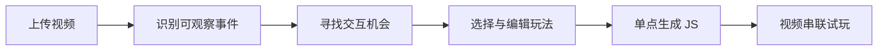

<div align="center">

# Video Analyzer · 视频分析器

### 从看懂视频，到找到交互，再到生成能玩的小游戏。

一个面向视频交互设计的 AI 工作台，连接视频理解、玩法推荐与 JavaScript 试玩。

<kbd>Python 3.10+</kbd> · <kbd>原生 JavaScript</kbd> · <kbd>FFmpeg</kbd> · <kbd>本地工作台 + 云端模型</kbd>

[项目介绍](#项目介绍) · [功能特性](#功能特性) · [安装与启动](#安装与启动) · [使用指南](#使用指南) · [常见问题](#常见问题) · [参与贡献](#参与贡献)

</div>

---

## 项目介绍

如果视频中的人刚接住篮球，能不能让玩家决定出手时机？如果角色正准备起跑，能不能把这一刻变成一次时机挑战？

**视频分析器希望帮助你把这样的想法变成可试玩的交互。**

上传一段视频，AI 会先识别可观察事件，再寻找适合玩家参与的位置，并推荐玩法。你可以调整位置、修改方案，然后为选中的单个玩点生成小游戏，最后沿着视频时间轴串联试玩。

它既适合体验“视频 + 小游戏”的创作流程，也适合学习多模态模型、提示词设计与 AI 代码生成。

> **玩法由你决定，AI 提供建议。** 模型描述不一定准确，代码检查通过也不代表游戏一定好玩。回看画面、修改方案和实际试玩，是这个工作流的一部分。

## 功能特性

| 功能 | 说明 |
| --- | --- |
| 视频事件识别 | 支持直接视频和顺序抽帧输入，按时间描述可观察事件，点击回看原片 |
| 交互机会发现 | 根据勾选的事件和对应画面寻找参与机会，支持调整位置、人工新增和删除 |
| 玩法推荐与编辑 | 比较推荐方案，自行修改玩家目标、操作、成功失败条件和反馈 |
| 单点生成游戏 | 每次只为一个玩点生成详细设计、JavaScript 与 CSS，不强制批量调用 |
| 版本与试玩记录 | 查看生成历史、按要求修复、记录试玩评价、采用版本和导出备份 |
| 视频串联试玩 | 播放到交互点时暂停并启动游戏，显示反馈后继续原片 |
| 项目管理 | 保存与恢复草稿、查看步骤进度、回收游戏版本及交互点 |
| 用量可追溯 | 保存提示词、原始响应、视频哈希与返回用量，在页面查看 Token 消耗 |

预设七类玩法：**点击物体、剧情选择、时机操作、连点、拖拽、按住后松开、短滑**。

### 工作流程



交互方式是：**原视频暂停 → 叠加小游戏 → 显示反馈 → 继续原视频**。玩家影响的是小游戏结果，不会改写原视频人物的真实动作或后续剧情。

## 安装与启动

### 1. 获取项目与运行环境

从本仓库页面下载 ZIP 并解压，或使用 Git 克隆。随后打开项目根目录，也就是包含 `README.md` 和 `demo/` 的文件夹。无需 Docker，也不需要准备 `.env`。

需要准备：

| 环境 | 用途 |
| --- | --- |
| **Python 3.10+** | 运行本地服务 |
| **FFmpeg 和 ffprobe** | 读取视频、抽帧和处理片段，需加入系统 `PATH` |
| **Node.js** | 检查生成的 JavaScript 语法，以及运行部分测试 |
| **浏览器** | 打开操作界面，建议使用较新的 Chrome 或 Edge |

在终端检查是否安装成功：

```sh
python --version
ffmpeg -version
ffprobe -version
node --version
```

后端使用 Python 标准库，前端无需打包，**没有额外的 `pip install`、`npm install` 或编译步骤**。

### 2. 启动工作台

在项目根目录运行：

```sh
python demo/app.py
```

打开浏览器，访问 **[http://127.0.0.1:8765](http://127.0.0.1:8765)**。没有密钥也能打开页面，查看工作台和配置服务。

服务运行期间保持终端打开，按 `Ctrl+C` 结束。端口冲突时使用 `python demo/app.py --port 8766`，再访问对应端口。

### 3. 在页面配置模型服务

点击右上角 **设置**，填写并保存，不需要修改文件或重启服务：

| 设置页 | 填写内容 |
| --- | --- |
| 视频分析 | HTTPS 服务地址（内网 IP 或 localhost 支持 HTTP）、API Key、分析模型列表（每行一个） |
| 游戏生成 | MiniMax 服务地址、API Key 和模型名 |
| 本地工具 | 可选的 FFmpeg、ffprobe、Node 路径；留空使用系统 PATH |

当前网页流程的模型分工：

| 任务 | 接入方式 | 发送内容 |
| --- | --- | --- |
| 识别视频事件 | Beeroute 配置的多模态模型，例如 `qwen3-vl-plus` | 视频或顺序采样画面 |
| 寻找交互机会、推荐玩法 | 页面选择的多模态模型，经 Beeroute 调用 | 对应画面及文字上下文 |
| 生成或修复游戏 | MiniMax | 当前单个玩点的文字方案，不发送视频或图片 |

分析服务默认地址为 `https://beeroute.ai/v1`；游戏生成默认使用 `https://api.minimax.cn/v1` 和 `MiniMax-M3.1-Flash`。模型名称须与你的账号实际支持的名称一致。自定义分析服务仍须支持当前多模态请求格式，并非任意兼容接口都能处理视频。

配置保存到本机 `config/settings.json`，后续请求立即采用新配置；正在执行的调用保持原快照。密钥不会回显，编辑时留空表示保留，可勾选清除。配置支持导入／导出，默认不导出密钥；包含密钥的导出文件需单独确认。

“检测本地工具”只运行版本命令，不调用模型。本机 JSON 中的密钥以明文保存，不是加密密钥库，请勿公开 `config/`。旧 `.env` 文件不会被删除，但程序不再自动读取；已设置的真实进程环境变量仍可供脚本使用，已有页面配置优先。

> **调用会产生费用。** 识别、机会分析、玩法推荐、生成和修复需要调用云端模型。分段、重新分析和修复可能增加调用次数。编辑草稿、查看记录、保存评价和单纯试玩本身不会调用模型。

## 使用指南

### 第一次体验

准备一段 **不超过 120 秒、30 MiB 的 MP4**。建议先用 10–20 秒、主体清楚、动作容易辨认的视频，例如倒水、拿起物体或准备起跑。

可以直接上传，也可以将素材放入自行创建的 `mp4-example/` 文件夹，再刷新页面选择。本仓库不保证附带示例视频。

| 页面步骤 | 你的操作 | 本步成果 |
| --- | --- | --- |
| **1. 视频分析** | 识别事件，回看原片，取消勾选失实描述 | 可信的可观察事件 |
| **2. 寻找交互机会** | 分析参与位置，检查理由并调整候选点 | 交互时间与参与建议 |
| **3. 玩法推荐与选择** | 比较方案，为每个点选择合适玩法 | 已选玩法 |
| **4. 玩法方案编辑** | 完善目标、操作、成功失败条件和反馈，确认描述 | 当前玩点的文字方案 |
| **5. 游戏生成与管理** | 核对输入后单点生成，打开版本详情试玩，按需修复 | 详细设计、代码和试玩记录 |
| **6. 视频交互编排** | 选择采用版本、开启参与、检查并保存，再开始播放 | 连续的视频交互体验 |

- **不需要一次完成所有点。** 可以只选一个玩点生成和试玩，确认方向后再继续。
- **补充说明是选填项。** 新增画面元素、具体判定规则和视频衔接可以留空；核心玩法说明仍需完整。
- **没有合适机会可以返回空。** 不要求每个镜头都出现小游戏。
- **改动后保留旧版本。** 调整位置或方案后，旧游戏可能被标记为需要重新核对，而不是被覆盖。

### 使用示例：把接球瞬间变成蓄力操作

以下是设计思路示例，**不是某次模型运行的保证结果**：

1. 上传一段接球视频，让模型识别“人物接住并持有物体”等可见事件。
2. 回看并选择一个合适位置，提出“让玩家控制接下来动作的力度或时机”。
3. 选择或编辑“按住后松开”玩法，说明玩家目标和成功失败条件。
4. 只为这个点生成游戏，检查蓄力控件、松开判定、反馈与结束是否正常。
5. 采用通过试玩的版本，加入编排；视频到点后暂停，游戏结束再继续。

同样的流程也可以尝试切菜、倒饮料或准备起跑。操作方式应与当前画面有关，而不是给不同视频套上同一套文案。

## 项目结构

```text
Video-analyzer/
├─ demo/
│  ├─ app.py                  启动入口
│  ├─ video_analyzer/         后端：媒体、模型、项目、游戏与存储
│  ├─ web/                    网页与原生 JS/CSS
│  ├─ tests/                  本地测试及模拟服务
│  └─ tools/                  实验、分析与历史记录恢复工具
├─ prompts/
│  ├─ vN/                    分阶段提示词版本
│  ├─ games/                 小游戏类型目录
│  └─ game-generation/        游戏生成与修复提示词
├─ mp4-example/               自行准备的本地素材
├─ projects/                  项目草稿、修订、编排和回收记录
├─ results/                   模型原始响应、代码产物和试玩记录
├─ config/                    本机私有设置（自动创建，不提交 Git）
├─ AGENTS.md                  仓库开发约定
└─ README.md                  项目说明
```

`projects/` 和 `results/` 保存运行数据，不需要额外数据库。模型生成的 `game.js`、`style.css`、`design.json` 按模型、视频和玩点归档，试玩记录放在对应玩点的 `试玩/` 子目录。

### 保存、备份与恢复

- **项目保存**：编辑自动保存，也可手动保存；支持重新打开已有项目。
- **原视频保管**：上传视频不作为长期副本保存在项目中，恢复时仍需重新选择同一个原文件。
- **两种备份**：草稿备份可导入恢复；游戏 ZIP 可留存方案、版本、代码和记录，但不含原视频，目前不支持整包一键导入。
- **另存副本**：只复制项目草稿，不复制原项目的完整游戏库。
- **删除与回收**：游戏版本和交互点可从页面回收站恢复；整个项目删除后移入 `projects/.trash/`，目前需手动恢复。

## 常见问题

<details>
<summary><strong>为什么一定要重新选择原视频？</strong></summary>

工作台需要用原视频定位画面和播放交互。项目恢复时会核对视频哈希，确认没有换成另一份素材。没有匹配视频时仍可查看部分文字内容，但不能正常完成分析和试玩流程。

</details>

<details>
<summary><strong>视频能播放，为什么模型分析失败？</strong></summary>

分析还涉及 FFmpeg 处理、网络请求和模型输出校验。请先检查时长、大小、密钥和本机 FFmpeg，再查看错误详情，不能单凭分析失败认定视频损坏。

使用 v14 事件提示词时，超过 25 秒的视频会分段处理，输出截断时可能继续缩短片段，因此一次操作可能对应多次计费请求。

</details>

<details>
<summary><strong>模型能听到视频里的声音吗？</strong></summary>

顺序抽帧没有声音。直接视频是否分析音轨取决于所选模型与实际输入流程；`qwen3-vl-plus` 按画面理解，v14 事件识别流程也只分析画面。文件含音轨不等于模型使用了音频。

</details>

<details>
<summary><strong>在哪里看 Token 消耗？</strong></summary>

页面用量面板显示最近事件识别、机会分析和玩法推荐的输入、输出及总 Token；游戏版本详情显示该次生成或修复的用量。有返回用量的失败请求也会展示，缺失值标为“未返回”。这些数据不是项目累计账单，也不会自动换算费用。

</details>

<details>
<summary><strong>生成代码通过检查，是不是就能放心使用？</strong></summary>

不是。结构与语法检查不等于玩法正确或运行稳定，仍需测试成功、失败、超时和退出。小游戏在受限的沙箱 iframe 中运行，但浏览器沙箱不是完整的 CPU／内存隔离。本项目适合作为可信本地环境中的原型，不应直接暴露为公共代码执行服务。

</details>

<details>
<summary><strong>找不到 Node.js，或者端口被占用，怎么办？</strong></summary>

先确认 `node --version` 可执行。必要时打开“设置 → 本地工具”，填写 Node 可执行文件的绝对路径，保存后检测。端口冲突时使用 `python demo/app.py --port 8766` 启动，再访问新端口。

</details>

## 数据与隐私

- 工作台在本机启动，但 **AI 分析不是完全离线运行**：视频、抽取画面或文字方案会发送到你配置的模型服务。
- 请只使用自有或获准使用的素材，不上传无权处理的个人信息和敏感内容。
- `config/settings.json` 保存本机密钥，不应提交或公开；默认导出的配置不包含密钥。
- 原始响应、抽帧图片、生成记录和人工备注可能包含输入内容。分享项目、备份或发布仓库前，请检查并移除不宜公开的数据。

## 参与贡献

欢迎通过问题反馈、文档修正、体验建议、测试用例和代码改进参与项目。

### 反馈问题

通过仓库的问题反馈入口（如 Issues）提交，建议包含：

```text
问题：在哪一步遇到了什么情况？
环境：操作系统、Python / Node.js / FFmpeg 版本
复现步骤：依次点击了哪些操作？
预期结果：希望发生什么？
实际结果：发生了什么？
附件：截图、脱敏错误信息、可公开的最小示例
```

请不要在反馈中粘贴 API Key、包含密钥的配置文件或无权公开的视频。

### 提交改进

1. 阅读 [AGENTS.md](AGENTS.md)，了解目录职责和代码约定。
2. 为修改补充对应测试；界面变更附上截图。
3. 运行本地测试，说明验证结果及仍存在的限制。
4. 提交 Pull Request，写清改动目的和影响范围。

```sh
# Python 单元、接口及相关前端测试
python -m unittest discover -s demo/tests -v

# 单独检查页面逻辑
node demo/tests/ui_smoke.js
```

本地测试使用模拟模型响应，不产生模型调用费用。`demo/tools/evaluation/` 中的真实实验工具可能计费，请先阅读参数说明。

提示词默认通过新版本迭代，原始响应和失败案例保留用于对照；请不要用一次成功或格式校验通过替代实际质量验证。

## 许可证

当前仓库尚未提供 `LICENSE`。正式开源前需确定代码许可证，使用和分发条件以届时发布的许可证文件为准。

第三方素材和模型服务遵循各自的授权与使用条件，不因本项目代码公开而自动获得授权。

## 致谢

感谢提供视频处理能力的 FFmpeg 项目，以及为本项目提供视频理解和代码生成能力的模型与服务。也欢迎每一位通过反馈、测试和文档帮助项目改进的使用者。

---

<div align="center">

**找到值得参与的瞬间，把设想变成能够试玩的体验。**

</div>

### 分析输出与等待

在设置的“视频分析”中可调整输出上限（默认 16384 Token，含思考）和 Qwen 思考模式。思考模式默认请求关闭，也可开启或使用网关默认；是否生效取决于服务端支持。模型名称保留原样。提高额度可能增加实际用量及等待时间。视频回看底部显示请求等待时间；思考消耗过高导致截断时，会保留原始响应并提示调整配置，不再自动拆段重复调用。


内网 Qwen 部署若忽略顶层 `enable_thinking`，可在设置中将“思考参数位置”改为 `chat_template_kwargs`；模型返回的思考 Token 才是是否生效的核验依据。玩法推荐每批支持 1–5 个点，小批次保留每点图片并覆盖全部已选点。失败批次不自动重试，未返回的用量不作为零汇总。
