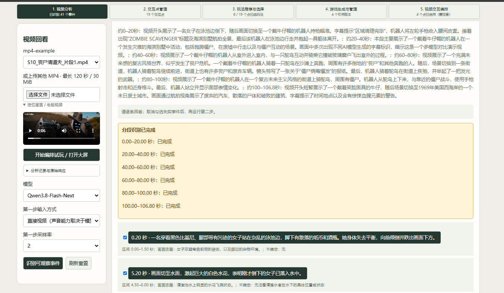
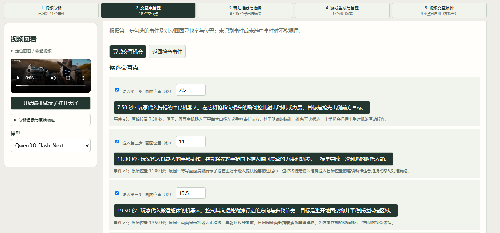
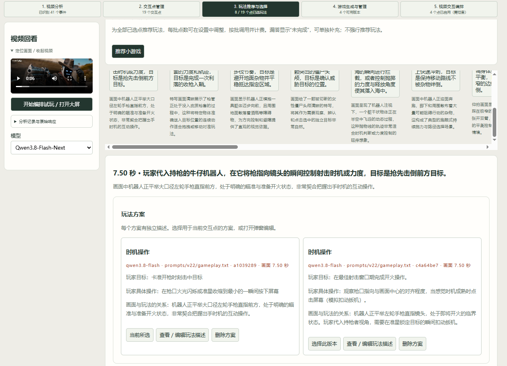
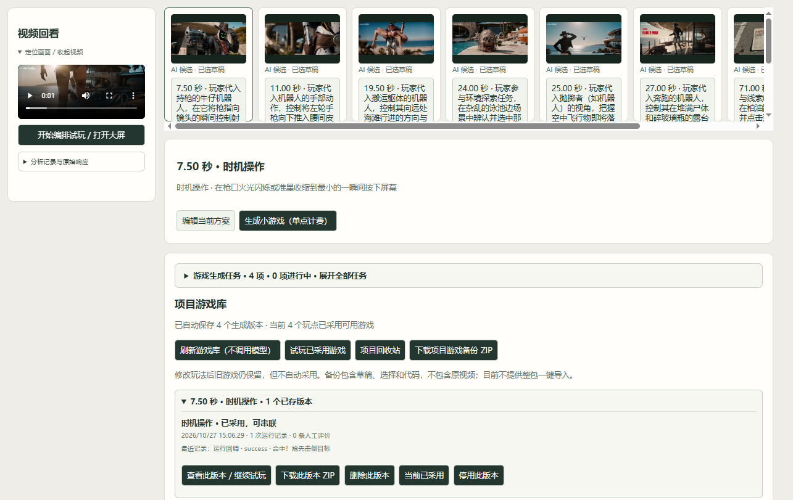
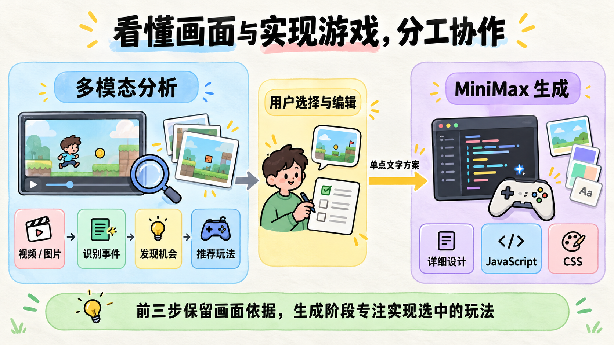
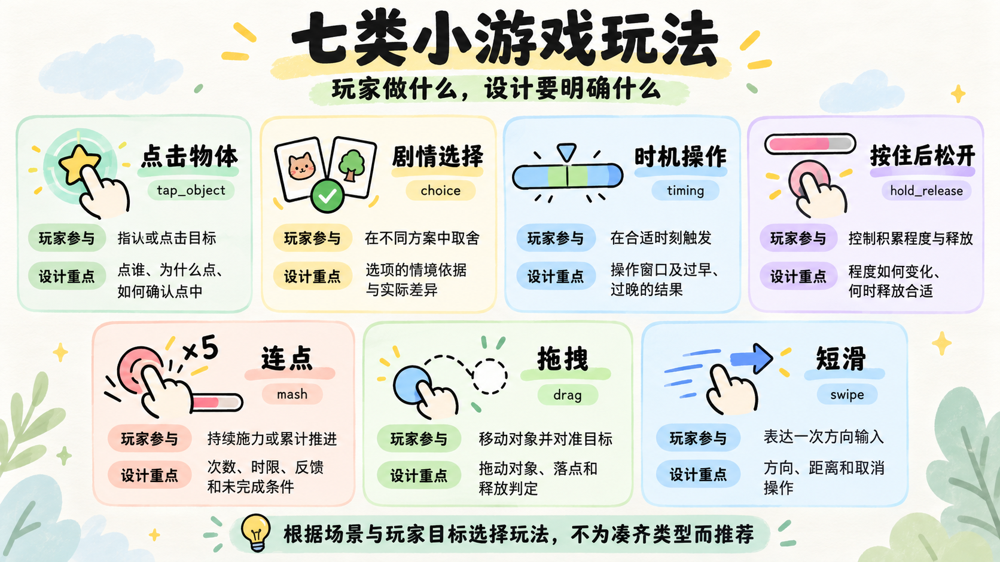
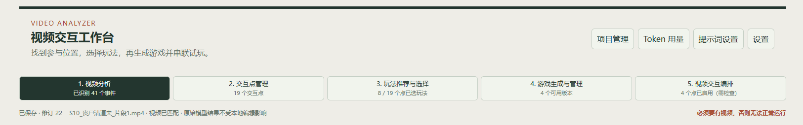
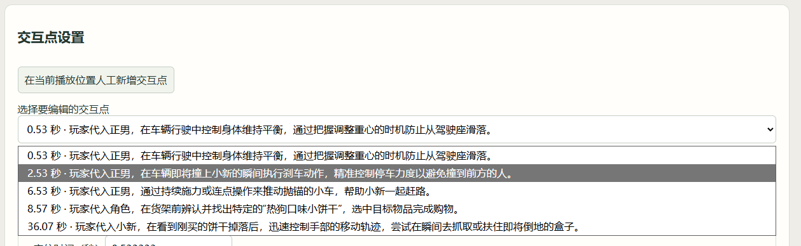
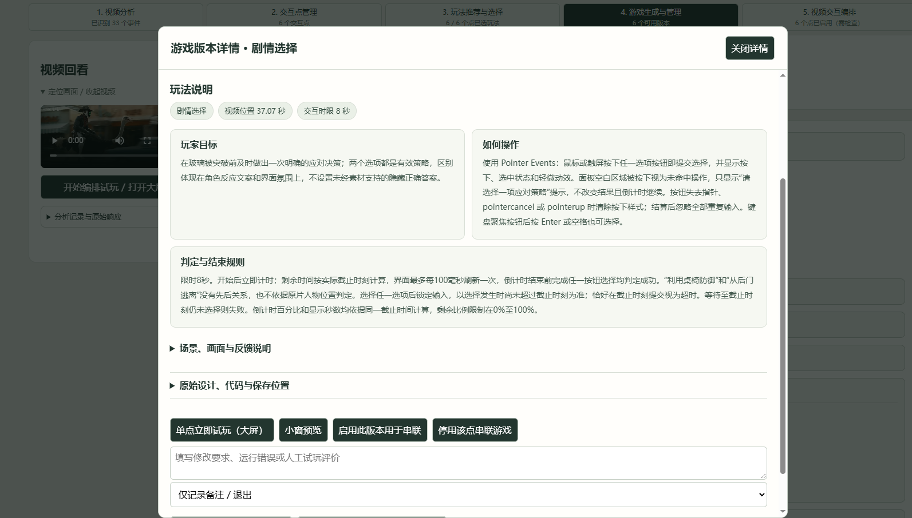
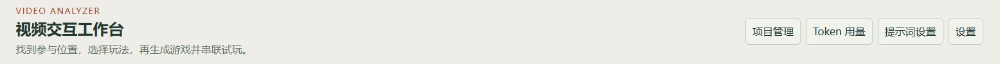

# 视频分析器项目总结

## 一 项目目标

任务目标：用户给出一段视频，AI 识别画面发生的事件，寻找适合玩家参与的位置，结合预设小游戏类型推荐玩法，再把用户选定的方案生成 JavaScript 游戏，放回视频中试玩。

### 1 视频分析

(1)顺序抽帧:程序明确提供图片及时间戳
(2)直接视频:保留了视频输入形式，模型实际如何采样由接口和服务端决定。
调用模型接受这两个方式的其中一个，输出“记录可观察事件:包括动作起止、代表画面时间、具体描述、画面依据"。

### 2 寻找交互机会

用户回看事件并选择需要继续分析的画面。
调用模型接收这些事件和对应图片，说明玩家可以参与谁的行为、控制哪个环节，以及为什么这个位置适合参与，生成 "交互点"。

### 3 推荐和选择玩法

调用模型读取交互点、当前对应画面和预设目录，推荐有实际差异的玩法方案。
每个方案说明场景关系、玩家目标、操作、成功失败条件和反馈；没有合适玩法时允许明确不推荐。
用户可以比较方案、打开独立描述弹窗进行编辑，或者自行设计一个新方案。

### 4 单点生成游戏

每个已选玩点有自己的生成入口。点击某一个点，只提交该点当前采用的文字方案。调用 MiniMax 一次补全详细设计并生成 JS、CSS游戏。

### 5 视频交互编排与试玩

用户选择每点采用的游戏版本，设置是否参与播放。在大屏中查看视频和简单时间轴，到达可用交互点时暂停原片并启动游戏，反馈后继续播放；也可以只试玩某一个点。

## 三 模型选择

### 1 模型差异

| 模型 | 本项目中的主要观察 | 对选择的影响 |
| --- | --- | --- |
| `gemini-2.5-flash-lite` | 初期响应较快；存在直传样例出现重复事件，部分身份和声音表述缺少可靠依据 | 适合关注响应速度的尝试，但需要检查重复生成和事实错误 |
| `qwen3-vl-plus` | 人物、物体及画面文字描述较细，适合展开事件；响应相对慢，也出现过误判 | 前期主要用于详细视觉分析，并作为后续交互机会与玩法实验的基础模型 |
| `qwen3.8-flash` | 速度与描述详细程度较均衡，部分声音和意图判断偏推测 | 保留为效率与内容表现的对照方案 |
| `qwen3.8-omni-flash` | 尝试有声视频直传，但早期记录存在疑似漏检；有音频用量也不代表具体声音判断正确 | 用于探索声画分析，需要结合实际听轨核验，不仅依据模型名称判断能力 |
| `Qwen3.8-Flash-Next` | 配置调整后的速度与效果在使用感受上接近 Flash | 作为当前主要工作模型，保留可配置参数和其他模型对照，不把试用感受写成严格等效结论 |

备注：采用了 顺序抽帧、直接视频 两种模型传入方式

### 2 当前方案

当前采用“多模态分析模型处理前三步，MiniMax 实现选定单点游戏”的分工。

**视频理解与交互分析使用多模态模型。** 第一步读取视频或连续采样图片；第二步和第三步也会接收代表画面。因此这些步骤仍需要视觉能力，不能因为同时有事件文字就直接替换为纯文本模型。

**小游戏代码生成使用** `MiniMax-M3.1-Flash`**。** 输入是用户选定的单个玩点文字方案，任务是补全设计并生成 JS、CSS，不再重新识别视频。

## 四 提示词分层设计

### 1 提示词分层

| 层次与提示词 | 输入与主要职责 | 这样设计的原因 |
| --- | --- | --- |
| 事件识别 `events.txt` | 读取视频或顺序采样图片，记录事件起止、代表画面、具体行为、依据与不确定性 | 为后续提供事实基础；区分准备、执行和结束 |
| 交互点发现 `opportunities.txt` | 结合已选事件与对应图片，说明玩家参与谁的行为、控制哪个环节、目标是什么，并引用原画面 ID | 把事实转成参与机会。允许设计与实拍不同的下一步，同时保留当前画面的依据 |
| 玩法推荐 `gameplay.txt` | 结合交互机会、当前图片和七类玩法目录，每点提出最多两个有区别的方案，或说明不推荐原因 | 帮助用户比较“这里怎么玩”，明确目标、操作和反馈|
| 游戏生成 `generate.txt` | 读取一个已选玩点的文字方案，一次补全详细设计并生成 JS、CSS | 集中实现用户选中的游戏 |
| 游戏修复 `repair.txt` | 读取该点方案、上一版本、原始错误和用户反馈，定位原因并返回完整的新版本 | 保留原玩法目标，针对具体问题修改|

### 2 提示词优化

| 遇到了什么问题 | 做过什么尝试 | 优化后的变化与保留问题 |
| --- | --- | --- |
| 限制只选一两个动作前位置，要求后续执行证据，导致准备片段和连续动作容易没有候选 | v8、v9 加入跨题材示例并允许只见准备；v12 放开固定候选数量 | v12 六次双模型运行产生23个候选，建议更丰富，但仍有接球、投篮等动作错配，数量不等于正确率 |
| 一次调用同时识别视频和设计交互，难以判断是哪一步出错 | v13 拆成先识别事件、再结合原图找机会；v14 细分有意义的状态，并配合程序分段 | 增加了可回看、可选择的中间结果；S07分段后完成28条事件输出，但仍有片头误认和边界重复 |
| 机会只复述事件或罗列“投、传、运”，后续容易全部变成选择题 | v15机会提示词要求写清参与主体、控制环节和玩家目标 | 输入更接近时机、力度、方向等可操作行为；图片没看清时仍可能继承上一步错误 |
| 候选引用未发送的画面，示例又容易引导模型套用题材 | v21明确原样复制合法画面ID；v22删除素材型few-shot，并让七类参与思路平等 | 已有一次S05验证的四条候选引用均合法；跨题材准确性仍需测试，合法ID不保证描述正确 |
| 玩法偏向choice，或推荐阶段被完整规则和标注要求拖重 | 尝试禁止、降低choice优先级；再恢复七类平等。v20把精确参数留到生成阶段 | 形成“先选择玩法、再细化实现”的分工；禁止类型并未证明更好，不能只用类型分布评判质量 |
| 多点推荐漏答，不推荐原因格式错误会拖垮合法玩法 | 明确非空 `abstentions` 结构；v23要求逐点给推荐或理由，程序配合分批与警告 | 能区分不适合、未完成和格式异常，保留合法结果；超时需要同时调整部署与批次 |
| 游戏返回 `Invalid \escape`，或语法通过后出现 `classList` 运行错误 | 代码改为原文分段；生成自检加入DOM绑定、输入与结束检查，修复时提供原始错误 | 减少额外转义要求，修复依据更具体；仍可能出现分段缺失、截断或运行错误，必须试玩 |

### 3 如何判断优化是否有效

我主要比较三点：输出能否被读取、建议是否符合画面、游戏是否操作成立。  
固定素材、模型和输入设置，保留优化前后原文与失败记录。如果同时改变了程序分段、校验或批次，就单独说明，避免把工程改善全部算成提示词提升。

## 五 小游戏设计

我把玩家操作整理为七类，供推荐、编辑和生成共用

| 类型 | 玩家实际参与的内容 | 设计时需要说清楚的重点 |
| --- | --- | --- |
| `tap_object` 点击物体 | 指认或点击目标 | 点谁、为什么点、如何确认点中 |
| `choice` 剧情选择 | 在不同方案中取舍 | 选项的情境依据与实际差异 |
| `timing` 时机操作 | 在合适时刻触发 | 操作窗口及过早、过晚的结果 |
| `hold_release` 按住后松开 | 控制积累程度与释放 | 程度如何变化、何时释放合适 |
| `mash` 连点 | 持续施力或累计推进 | 次数、时限、反馈和未完成条件 |
| `drag` 拖拽 | 移动对象并对准目标 | 拖动对象、落点和释放判定 |
| `swipe` 短滑 | 表达一次方向输入 | 方向、距离和取消操作 |

设计分成两层：  
（1）推荐阶段用简洁文字说明参与意图；  
（2）生成阶段再补控件、默认数值、状态转换和结束条件。

## 六 功能优化

功能优化从实际使用中的问题出发，逐步改善页面组织、试玩、等待和成果管理。

### 1 内容堆在一页 → 按任务划分工作区

**原本：** 视频、事件、交互点、玩法和生成结果集中在同一页，内容越多页面越长，用户需要反复上下滚动，难以找到当前要操作的部分。

**优化后：** 拆成视频分析、交互点管理、玩法推荐与选择、游戏生成与管理、视频交互编排五个工作区。每个页面集中处理一个任务，用户可以按步骤推进，也可以返回前面的步骤继续修改。

### 2 候选与方案混在一起 → 先选交互点，再独立管理玩法

**原本：** 第二步产生的候选容易直接出现在后续页面，尚未选择玩法的点也会进入生成区域；点位设置、推荐内容和方案描述放在一起，多个方案的编辑关系不够清楚。

**优化后：** 用户明确选入的交互点才进入后续流程，并支持调整位置、人工新增和删除。每个玩法方案有自己的描述和编辑入口，自行设计保存为新方案，让“选哪个点、采用哪个玩法、修改哪份描述”更加明确。

### 3 点击后向下找内容 → 弹窗查看，长内容按需展开

**原本：** 点击生成小游戏或查看版本后，相关内容出现在页面下方，用户需要继续滚动才能找到。完整JSON、代码和任务记录直接铺开，也会挤占主要操作区域。

**优化后：** 玩法描述、生成输入和版本详情放入弹窗，在当前位置打开和关闭。原始响应、代码及任务历史默认折叠，需要时再展开，减少页面跳动和无关信息干扰。

### 4 右侧小窗试玩 → 大屏操作与说明展示

**原本：** 小游戏叠加在右侧较小的视频窗口里，控件和反馈不明显，点击、拖拽等操作空间有限，难以判断实际效果。

**优化后：** 增加大屏试玩、浏览器全屏和收起说明功能，视频与游戏层同步适配可用空间。右侧展示目标、操作和规则，保留小窗预览；关闭大屏后保留播放位置，方便返回编辑。

### 5 只显示正在调用 → 后台任务与等待状态可见

**原本：** 调用模型时主要显示“正在生成”等文字，耗时较长时无法判断已经等待多久。游戏生成依赖当前页面等待，用户不清楚切换、刷新后如何继续查看；失败提示也曾过于笼统。

**优化后：** 分析增加等待计时，游戏生成改为后台任务，展示等待、完成和失败状态。保持本地服务运行时，可以切换页面或刷新后继续查看。失败保留具体错误和原始输出，为后续定位和修复提供依据。

### 6 手动修改配置、用量不直观 → 页面设置与Token展示

**原本：** 模型地址、密钥和工具路径主要依赖 `.env` 或环境配置，普通用户设置成本较高。调用用量虽然保存在记录中，页面查看不够直观。

**优化后：** 通过设置弹窗填写服务、模型和工具路径，支持配置导入导出。前端展示输入、输出及总Token用量，未返回的部分标记为未知，帮助用户了解消耗并决定是否再次调用。

## 七 项目遇到的问题难点和解决过程

### 1、从视频描述到玩家参与，任务边界不清楚

**（1）遇到的问题和难点**

最初让模型同时描述视频、寻找交互点，结果容易停留在复述动作，或者直接编出与画面关联不大的玩法。为了避免误判不断增加限制，又导致部分准备动作和连续运动没有候选，难以兼顾事实准确和创意空间。

**（2）解决方案**

将流程拆为事件识别、交互机会和玩法推荐：先记录可观察状态，再结合对应图片说明玩家能参与什么，最后选择具体玩法。用户在阶段之间回看和筛选，也可以修改或自行设计。这样把事实判断与玩法构思分开，出现问题时能找到需要调整的环节。

### 2、交互建议与实际视频画面对不上

**（1）遇到的问题和难点**

模型会把已经持球说成等待接球、把出手后的姿态当作准备动作；还出现过输出未发送的画面ID。即使文字建议看起来合理，也可能定位到错误画面，后续玩法继续沿用错误描述。

**（2）解决方案**

为代表画面绑定唯一ID，由模型引用原ID，服务端根据实际抽取画面确定时间，不让第二步重新猜秒数。请求列出合法ID，校验时保留合法候选，排除错误引用而不自动改绑。页面提供点击回看、调整位置和删除功能，用户可以依据连续画面校准参与时刻；ID校验解决引用问题，主体和动作是否真实仍通过回看确认。

### 3、视频较长时输出截断，部分失败影响后续流程

**（1）遇到的问题和难点**

整段分析需要描述较多事件，曾在结果写完前达到输出上限，导致JSON不完整。分段后又出现不足一秒的尾段，被接口以“视频太短”拒绝。如果把整个任务都判为不可用，前面已经完成的事件也无法继续使用。

**（2）解决方案**

将视频按时间分段，切点适度重叠，再把局部时间换算回原片；过短尾段合并到前段，短视频可在调用前改用抽帧。保留每段状态和原始响应，明确哪些区间完成、失败或尚未处理。失败时仍展示合法的部分事件，允许选取这些画面继续寻找机会，避免因为局部失败丢掉全部工作。

### 4、模型返回有内容，但格式不符合程序约定

**（1）遇到的问题和难点**

分析响应出现过字段缺失、不推荐原因结构错误；游戏生成则多次出现 `Invalid \escape`。后者是代码被包在JSON字符串中产生非法转义，解析时就失败，还没有进入JS运行阶段。改为分段输出后，也出现标记缺失或设计段为空，说明单靠“严格按格式输出”无法保证稳定。

**（2）解决方案**

分析阶段明确字段类型，对时间、引用和核心玩法严格校验，辅助字段异常记录警告，尽量保留合法内容。生成阶段改为“设计JSON＋JS原文＋CSS原文”三段，减少长代码的额外转义要求；仅兼容边界明确的格式，保留原文和具体错误，供下一轮修复使用。这样可以区分格式失败与代码错误，避免盲目修改游戏逻辑。

### 5、生成代码通过语法检查，但实际操作仍会出错

**（1）遇到的问题和难点**

小游戏曾在点击后出现读取未定义对象 `classList` 的错误，也出现操作窗口太短、玩家还没来得及输入就结束等情况。语法检查只能确认代码能否解析，不能检查所有DOM关联、交互路径和体验参数。

**（2）解决方案**

在计费生成前检查Node等运行依赖，生成后执行语法检查，再在隔离环境中试玩。生成与修复提示词增加DOM初始化、坐标、取消输入、超时和结束清理的检查要求；将具体报错或体验问题连同旧版本一起提交修复，并保留新旧版本。通过实际操作分别检查成功、失败、超时和退出，起跑连点样例也据此调整了操作节奏。

### 6、小游戏与原视频的播放状态难以统一

**（1）遇到的问题和难点**

单个游戏可以独立运行，但放入视频后，还需要处理到点暂停、开始游戏、显示反馈、退出或报错后续播。不同游戏的计时和结束方式如果各自控制视频，就容易重复结束、反馈尚未显示便销毁，或影响下一个交互点。

**（2）解决方案**

建立统一运行协议：游戏通过 `mount(container, api)` 挂载，使用 `api.finish` 报告结果，通过 `destroy()` 清理资源。视频定位、暂停、反馈和恢复由宿主管理；同一时间只运行一个游戏，并忽略重复结束回调。使用沙箱iframe隔离生成代码，再通过单点和串联试玩检查衔接，让不同玩法共享一套播放流程。

### 7、内网模型调用慢，配置已发送却没有实际生效

**（1）遇到的问题和难点**

接入 `Qwen3.8-Flash-Next` 后，部分请求把输出额度用于思考，正文没有完成；发送关闭思考参数后，返回用量仍显示大量思考。玩法推荐每批五点还多次遇到约180秒的网关超时。同时，接口返回Token明细为 `null`，本地汇总又触发异常，掩盖了原来的失败原因。

**（2）解决方案**

先核对原始响应、结束原因和用量，修正模型名称大小写识别，并将思考、输出额度和批次设为可配置。通过小请求对照，确认该内网服务使用 `chat_template_kwargs.enable_thinking: false` 才能有效关闭思考；将推荐缩小到每批两点，保留图片输入。随后S08两点验证约20.2秒完成，思考Token为0。用量汇总同时增加空值兼容，缺失数据保留为未知，失败批次和已完成内容分别展示。

## 八 项目收获与后续复用

### 1 项目收获

**对多模态模型的使用有了实际认识。** 从准备素材、比较直传和抽帧，到核对响应、耗时及Token用量，我逐步熟悉了模型接入和效果验证。遇到识别不准、输出截断或调用超时时，能够结合请求参数和原始记录定位问题，再决定调整输入、配置还是处理流程。

**学会围绕任务持续调整提示词。** 项目从一次调用直接寻找交互点，发展为事件识别、机会发现、玩法推荐和代码生成的分层流程。每次调整都对应具体问题，例如候选过少、玩法偏向选择题、图片引用错误或输出格式不完整。这个过程让我更重视职责划分和前后结果对照，也意识到提示词需要与程序校验、人工回看配合使用。

**把AI生成代码推进到了实际调试。** 通过单点生成、检查、试玩和修复，我进一步理解了输入事件、DOM引用、坐标计算、计时、状态切换及资源清理。面对报错，需要提供具体的错误位置和复现操作；面对窗口太短、反馈不清等体验问题，则要结合试玩调整规则。修复后的版本也需要再次操作验证。

**从实现功能转向关注完整使用过程。** 大屏试玩、时间轴、弹窗、后台任务、项目保存和游戏库等调整，都来自实际使用中的不便。我开始从用户完成一个作品的过程考虑功能：能否找到当前操作、理解等待状态、修改已有方案，以及在下次打开时继续工作。

### 2 后续可以复用的内容

| 已形成的能力 | 后续接入影游平台时的用途 |
| --- | --- |
| 分阶段分析流程与画面定位 | 将视频事件、交互机会和玩法建议逐步交给用户确认，并定位回原片 |
| 七类玩法目录与方案描述 | 统一玩家目标、操作和反馈的表达，作为推荐、编辑和生成的共同输入 |
| 单点生成与修复流程 | 按选定玩点生成游戏，结合具体问题迭代，保留不同版本供比较和采用 |
| 游戏运行协议与视频宿主 | 复用游戏挂载、结束、清理，以及视频暂停、反馈和续播的衔接逻辑 |
| 项目、版本与试玩记录 | 保存创作进度，追踪方案到代码的来源，并为后续问题分析提供记录 |

这些内容可以作为后续平台功能的原型基础。正式接入时，还需要结合平台现有的数据结构、素材服务和播放器进行适配。

这次项目让我完整经历了从视频理解、交互设计到代码生成和试玩调试的过程，也形成了可以继续扩展的工具与记录。后续会以真实素材和实际体验为依据，继续改进识别质量、玩法适配和生成稳定性。

